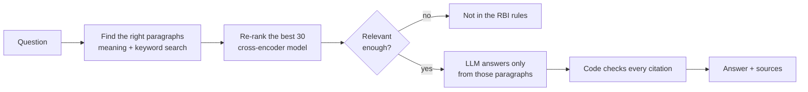

# AdvancedRag

**An AI assistant for RBI rules. Ask in English, Hindi or Hinglish, and get the correct
rule with the exact paragraph it comes from.**

[](https://github.com/RahmatAli-15/Advanced_Rag/actions/workflows/ci.yml)


> **Question:** *Gold loan par LTV ki limit kitni hai?*
>
> **Answer:** Up to ₹2.5 lakh: **85%** · ₹2.5–5 lakh: **80%** · above ₹5 lakh: **75%** **[S1]**
>
> **[S1]** RBI (NBFC – Credit Facilities) Directions, 2025 → opens the exact paragraph and the official RBI page

---

## The problem

Finance companies in India (NBFCs: lenders, gold-loan companies, loan apps) must follow
the Reserve Bank of India's rules. Those rules are **45 long documents** with thousands
of paragraphs, and they **change often**. A wrong answer can mean a penalty.

General chatbots are risky here: they give no source, may be out of date, and guess
confidently when they do not know.

## What AdvancedRag does

| | |
|---|---|
| 💬 **Answers with proof** | Every sentence cites the RBI paragraph it came from; one click opens the official text |
| 🚫 **Says "I don't know"** | If the rules don't cover a question, it refuses instead of guessing |
| 🗣️ **Three languages** | English, Hindi and Hinglish, answered in the same language and script |
| 📅 **Rules on any date** | "What was the rule in January?": every version of every rule is kept |
| 🔔 **Tracks RBI changes** | Checks RBI daily; an AI agent explains each change: what changed, who it affects, what to do |
| 🤖 **Works inside AI tools** | Claude, Cursor and VS Code can use it as a tool (MCP) |
| 📊 **Monitored** | Dashboard of speed, errors, cache hits and cost per answer |

## How it works



A background worker downloads the RBI rules every day, splits them into 3,707 clauses,
keeps every version, and finds and explains what changed.

## Results (measured, not guessed)

| What was tested | Result |
|---|---|
| Right paragraph in the top 5 (144 questions, 3 languages) | **96.5%** |
| Answer claims supported by their source (checked by a second AI) | **95.9%** |
| Numbers in answers found in the cited paragraph | **100%** |
| Off-topic questions correctly refused | **20 / 20** |
| Repeat question answered from cache | **~5 ms** instead of ~3 s, no AI cost |
| 16 users at once (after adding load protection) | response time **3.8 s** instead of 38 s |
| Own reranker trained by distillation | **4.8× smaller, 7× faster**, 71% of the accuracy gap closed |
| Automated tests on every commit | **222 backend + 25 frontend** |

## What makes it more than a RAG demo

- **Grounded:** a relevance gate, "not in sources" option, and code that verifies
  every citation; the change agent's quotes are checked word for word.
- **Evaluated:** retrieval, answer faithfulness, refusals and load are all measured,
  and every number above has a report in [`eval/reports/`](eval/reports).
- **Production-minded:** an LLM gateway (retries, 3-key and model fallback, circuit
  breaker, daily token budget), cache, job queue with retries and dead-letter queue,
  rate limiting and load shedding, Prometheus + Grafana.
- **Own deep learning:** a 118M reranker distilled in PyTorch from a 568M teacher, so
  the system can run on a CPU server.
- **Documented decisions:** 15 short [design records](docs/adr) explain each choice and
  the alternatives.

## Tech stack

| Area | Technology |
|---|---|
| Backend | Python 3.12, FastAPI, SQLAlchemy (async), Alembic |
| Frontend | React 19, Vite |
| Data | PostgreSQL + pgvector (rules, versions, vectors, full-text search), Redis |
| Search models | BAAI bge-m3 (embeddings), bge-reranker-v2-m3 + own distilled reranker (PyTorch) |
| LLMs | Groq (gpt-oss-120b, gpt-oss-20b) behind an own LLM gateway |
| Agent & tools | LangGraph (change-impact agent), MCP server |
| Operations | Docker Compose, Redis Streams job queue, Prometheus, Grafana, GitHub Actions CI |

## Quick start

Needs Docker, Python 3.12, Node 22 and a free [Groq API key](https://console.groq.com/keys).

```bash
cp .env.example .env                  # put your GROQ_API_KEY in .env
docker compose up -d postgres redis   # database + cache

cd backend                            # API on http://localhost:8000/docs
python -m venv .venv && .venv/bin/pip install -e ".[dev,ml]"
.venv/bin/alembic upgrade head
.venv/bin/python -m app.ingestion.cli rbi-master-directions --match "Non-Banking" --history
.venv/bin/python -m app.ingestion.cli chunk && .venv/bin/python -m app.ingestion.cli embed
.venv/bin/uvicorn app.main:app --port 8000

cd ../frontend                        # chat UI on http://localhost:5173
npm install && npm run dev
```

The first load downloads the RBI directions (politely, 3 s apart) and the models, so it
takes a while. Windows commands, the worker, MCP setup, monitoring, evaluation and
training: see the **[developer guide](docs/developer-guide.md)**.

## Learn more

| Document | For |
|---|---|
| [Explained simply](docs/explained.md) | What, why, how, HLD/LLD, guardrails, cost, interview Q&A, in plain language |
| [System design](docs/design.md) | Architecture, request flow, data model, failure handling |
| [Design decisions (ADRs)](docs/adr) | Why each choice was made, with alternatives |
| [Developer guide](docs/developer-guide.md) | Every command to run, measure and extend it |
| [Evaluation](eval/README.md) | How the test sets were built and their limits |

## Project structure

```
backend/app/
  ingestion/   crawler, parser, versioned storage, CLI
  chunking/    clause-aware splitting
  retrieval/   hybrid search, reranking, load-shedding gate
  answer/      grounded answers, citation checks, cache
  llm/         LLM gateway (fallback, retries, circuit breaker, budget)
  changes/     change detection + LangGraph impact agent
  distill/     reranker distillation (PyTorch)
  eval/        retrieval / answer / load evaluation
  queue/       Redis Streams job queue
frontend/      React chat UI
docs/          explainer, system design, ADRs, developer guide
eval/          test sets and measured reports
ops/           Prometheus + Grafana config
```

## Roadmap

Done: crawler and versions · hybrid search + reranking · cited answers · streaming UI ·
LLM gateway · evaluations · cache · job queue and change tracking · monitoring · MCP ·
load protection · change-impact agent · distilled reranker.

Next:
- [ ] Human spot-check of the test set (currently AI-reviewed, and labelled so)
- [ ] Exact-term test questions (e.g. "V-CIP", "NOF")
- [ ] On-demand AWS deployment (Terraform) on a CPU server, using the distilled reranker

**Not planned on purpose:** a "similar question" cache. "Can NBFCs do video KYC?" and
"Can banks do video KYC?" are similar questions with different answers, so only exact
repeats are reused.

## Scope and disclaimer

Covers the RBI's Master Directions for NBFCs (45 directions). Not SEBI, IRDAI or bank
directions yet. **Not legal advice**: it always links the official text so a person can
confirm.

## License

[MIT](LICENSE) © 2026 Rahmat Ali
