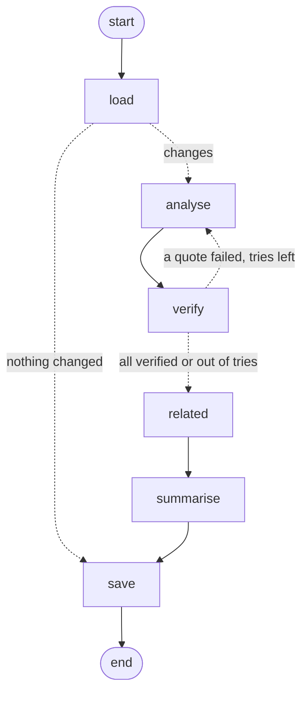

# ADR 0014: Change-impact agent

**Status:** Accepted · **Date:** 2026-11-18

## Context

Change detection (ADR 0010) shows *which* paragraphs of a direction changed, as raw
before/after text. A compliance team needs the next step: what is different, who it
affects, what to do, and which other rules to check. Reading a 600-word paragraph diff
for that is slow and easy to get wrong.

## Decision

**A small LangGraph agent** (`app/changes/impact.py`) runs after each diff (worker job
`analyse_impact`) or on demand (`cli analyse-impact`). The graph, drawn from the code:

| Node | Kind | Does |
|---|---|---|
| load | code | Change event + the **full** old/new text of each changed paragraph (the stored diff is cut at 600 characters) |
| analyse | LLM, JSON | Per paragraph: what changed, change type, severity, who is affected, action, exact quotes from both versions, a search query |
| verify | **code** | Every quote must appear word for word in the right version and must cover text that actually changed |
| related | tool | Retrieval with each search query: other clauses to "check also" |
| summarise | LLM | 2-4 sentences for a head of compliance, from verified analyses only |
| save | code | `change_events.impact` (JSONB), served by `/changes`, the UI and MCP |

**Verification is code, not another model.** The answer pipeline already learned that
a model's output must be checked against its sources (ADR 0007, 0009). Here a quote that
is not in the text, or that appears unchanged in both versions, proves nothing, so the
paragraph goes back to `analyse` with the reason ("after_quote is not in the AFTER text
word for word"), at most twice. After that it is kept but marked **unverified**, and the
summary uses only verified paragraphs.

**LangGraph for orchestration only.** State, conditional edges and the retry loop are
what it is good at. Model calls stay in our LLM gateway, so the agent gets fallback,
rate limiting, the token budget and metrics like every other caller, with no second
LLM client library.

## Real test: an actual RBI amendment

The crawler only recently started storing full text, so for older amendments only the
dates were known. `cli changes-from-archive 12957 20260608114823` fetches the Internet
Archive's snapshot of the Credit Facilities Directions from 2026-06-08 (before the
amendments in force from 2026-07-01 and 2026-07-15) and diffs it against the current
text through the normal pipeline. The event is labelled `archive_backfill` with the
snapshot URL. Result:

| Para | Agent's reading | Severity | Check also (score) |
|---|---|---|---|
| 3(3) | Exemption (v) now names "Type I NBFC" instead of "NBFC not availing public funds and not having any customer interface" (scope change) | high | The same applicability lists in three other directions (0.99) |
| 70 | New Explanation: independent viable units may be financed as separate projects with their own financial closure (relaxation) | medium | Resolution of Stressed Assets, para 111(2), project cost overrun (0.43) |
| 72 | New Explanation on right of way for generation-plus-transmission projects (clarification) | low | none above the threshold |

All three paragraphs passed the quote check on the first attempt; the retry loop is
covered by a test with a scripted model.

**Tuned on this run:** "check also" first used the answer gate's relevance floor (0.05)
and suggested a fraud-closure clause for a project-finance change. Related clauses
scored 0.43-0.99 and unrelated ones 0.11-0.21, so the floor for suggestions is 0.4.

## Limitations

- Severity and change type are model judgements: between two runs, para 3(3) was rated
  "medium" then "high". Quotes are verified; labels are not. The UI says "AI analysis,
  confirm against the official text".
- One real change so far (three paragraphs). More will come from the daily crawl; a
  labelled set of changes would be needed to measure the agent like the answers.
- At most 8 paragraphs per change are analysed (the rest are counted), to bound cost.

## Alternatives considered

- **A plain function instead of a graph:** fine for a straight line, but the
  verify-and-retry loop and the skip-when-nothing-changed branch are clearer as edges.
- **A ReAct agent choosing its own tools:** less predictable and harder to test; every
  step here is known in advance, so a fixed graph is enough.
- **LLM-as-judge for verification:** a second model can be wrong the same way; exact
  string checks cannot.
