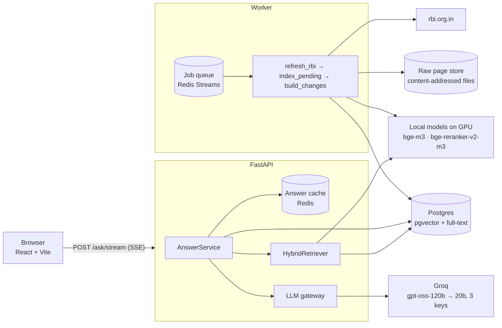
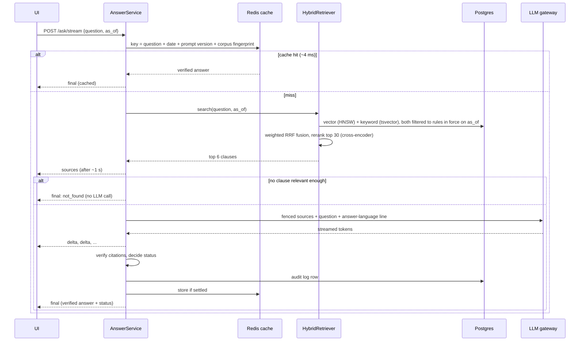
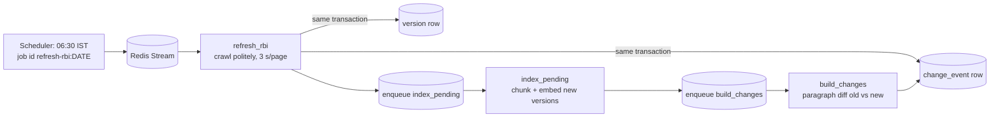
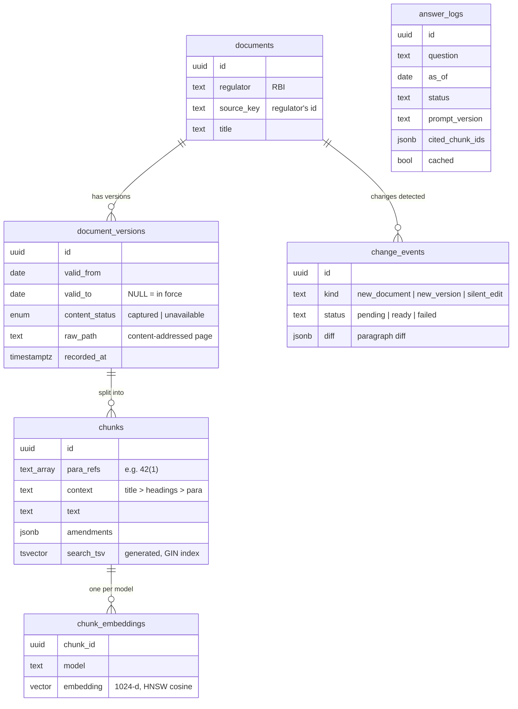

# AdvancedRag: system design

High-level design (what the parts are and how they talk) and low-level design (the
modules, interfaces and patterns inside them) of what is built today. Each decision
links to its ADR in [`docs/adr/`](adr/). Numbers are measured on a laptop (RTX 3050,
4 GB) unless stated otherwise.

**Contents:** [1. Problem](#1-problem) · [2. Architecture](#2-architecture) ·
[3. Answering a question](#3-answering-a-question) · [4. Keeping the corpus current](#4-keeping-the-corpus-current) ·
[5. Data model](#5-data-model) · [6. Low-level design](#6-low-level-design) ·
[7. Failure handling](#7-failure-handling) · [8. Capacity and scaling](#8-capacity-and-scaling) ·
[9. Not built yet](#9-not-built-yet)

---

## 1. Problem

Compliance teams at Indian NBFCs need answers like "how often must we update KYC for
high-risk customers?" that are:

- **correct for a date**: rules are amended; the answer for March differs from November
- **traceable**: every sentence points at a paragraph of a specific version
- **honest**: "the sources do not cover this" beats a confident guess
- **current**: RBI changes are picked up without anyone running commands

Plain RAG fails at each of these (see the README, "Why this is hard").

## 2. Architecture

| Component | Responsibility | Key choice (ADR) |
|---|---|---|
| React UI | Ask, stream the answer, open cited clauses, show recent changes | SSE over fetch (0008) |
| FastAPI | `/ask`, `/ask/stream`, `/search`, `/changes`, `/corpus`, `/health/*` | Async throughout; models warm up in the background |
| Postgres + pgvector | Documents, versions, chunks, vectors, full-text index, audit log, change events | One store for everything (0001) |
| Local models | Query/chunk embeddings (bge-m3, multilingual) and reranking | Free, private, no quota |
| LLM gateway | The only path to an LLM: fallback, retries, rate limits, circuit breaker, daily token budget | (0002, 0011) |
| Redis | Answer cache, job queue, token-budget counter | Simple uses of one service |
| Worker | Daily crawl, indexing, change diffs, impact analysis | Hand-written queue on Redis Streams (0010) |
| Change-impact agent | Explains each change: what, who, action, related clauses | LangGraph with code-verified quotes (0014) |
| MCP server | `ask_compliance`, `search_regulations`, `recent_changes` for AI assistants | Thin client of the API (0012) |
| Prometheus + Grafana | `/metrics` scrape, dashboard for latency, outcomes, cost, queue | Metrics at three choke points (0011) |

## 3. Answering a question

Design points:

- **As-of filtering happens inside the search**, not afterwards, so the top results are
  always rules that were in force on that date (0005).
- **Two gates before an answer is shown**: a retrieval-score threshold (no LLM call when
  nothing is relevant) and the model's own "not in sources" signal (0007).
- **The streamed text is a preview; the final event is the record.** Citations are
  verified only on the complete answer (0008).
- **Statuses are explicit**: `answered`, `not_found`, `no_coverage`,
  `insufficient_sources`, `ungrounded`, `llm_unavailable`.

## 4. Keeping the corpus current

- **Versioning is bitemporal**: `valid_from`/`valid_to` say when a rule applied;
  `recorded_at` says when we learned it. Validity windows are recomputed with `LEAD()`.
- **Transactional outbox**: a change event is written in the same transaction as the
  version, so no change is lost and none is announced without its data.
- **Every stage is idempotent**, so retries and at-least-once delivery are safe.
- **The crawler never pushes through bot protection**: a blocked crawl is not retried
  (0003).

## 5. Data model

`crawl_runs` (one row per crawl, with stats and errors) is omitted from the diagram.

## 6. Low-level design

| Package | Responsibility | Main types |
|---|---|---|
| `ingestion/` | Polite HTTP, robots.txt, RBI parsers, raw store, version repository, crawl pipeline | `PoliteClient`, `RawStore`, `repository`, `crawl_master_directions` |
| `chunking/` | Clause-aware chunking with paragraph numbering and amendment links | `chunk_blocks`, `ChunkDraft`, numbering tracker |
| `embeddings/` | Embedder and reranker behind small interfaces, real or fake | `Embedder`, `Reranker`, factories |
| `retrieval/` | Hybrid search, weighted RRF, reranking, as-of filter | `HybridRetriever`, `SearchFilters`, `SearchHit` |
| `llm/` | Provider adapter, gateway, streaming | `GroqProvider`, `LLMGateway`, `ModelRoute` |
| `answer/` | Grounded answers, citation verification, cache | `AnswerService`, `AnswerCache`, `CorpusFingerprint` |
| `changes/` | Paragraph diffs for change events | `diff_raw`, `process_change_events` |
| `queue/`, `worker.py` | Job queue and the daily job chain | `Queue`, `Worker`, `PermanentError` |
| `eval/` | Retrieval and answer evaluation, latency benchmark | `eval-retrieval`, `eval-answers`, `bench-retrieval` |

Patterns, and where they are used:

| Pattern | Where | Why |
|---|---|---|
| Adapter | `GroqProvider` implements the `Provider` protocol | Swap or add LLM providers without touching callers |
| Chain of responsibility | Gateway routes `model@key1 → @key2 → @key3 → smaller model` | Best model first, degrade gracefully |
| Circuit breaker | One per route in the gateway | A failing model stops adding latency |
| Token bucket | Client-side rate limiter per route | Stay under provider limits instead of collecting 429s |
| Repository | `ingestion/repository.py` | Idempotent upserts in one place |
| Transactional outbox | `change_events` written with the version | No lost or phantom change notifications |
| Ports (protocols) | `Embedder`, `Reranker`, `AnswerCachePort` | Real models and Redis in production, fakes in tests |
| Factory + DI | `build_gateway`, `build_embedder`; objects created once in the FastAPI lifespan | One place to wire dependencies |

Testing: unit tests for pure logic (parsers, chunker, fusion, citation parsing, diff);
integration tests against a real Postgres and Redis (rolled back or prefixed and
cleaned up); fakes for LLMs and models. 180 backend tests and 25 frontend tests run in CI.

## 7. Failure handling

| Failure | What happens | User sees |
|---|---|---|
| LLM rate-limited | Same model on the next key at once; smaller model only after all keys | A normal answer, maybe from 20b |
| Daily LLM quota used up | Long `Retry-After` → skip to the next route instead of retrying | Answer from another route, or `llm_unavailable` |
| All LLM routes down | `llm_unavailable` | The most relevant clauses, without a generated answer |
| LLM stream dies midway | Not spliced onto another model; `StreamInterrupted` | `llm_unavailable` plus clauses |
| Model cites in a new format | Citations normalised; unknown ids removed | Never a citation without a source |
| Redis down | Cache skipped; worker paused | Slower repeats, nothing breaks |
| Postgres down | `/health/ready` returns 503 | Load balancer holds traffic |
| Worker crashes mid-job | Job not acked, reclaimed after the visibility timeout | Nothing |
| Job keeps failing | 3 attempts with backoff, then dead-letter queue | `python -m app.worker dead` shows it |
| RBI shows a bot challenge | Crawl aborted, not retried | Yesterday's data; nothing pushed through |

## 8. Capacity and scaling

Today: 45 RBI NBFC directions, 96 versions, 3,707 chunks. Vectors take about 15 MB
(3,707 × 1,024 × 4 bytes) plus the HNSW index.

| Resource | Today | Limit it hits first | Next step |
|---|---|---|---|
| LLM | Groq free tier, 8k tokens/min per key; one answer ≈ 4–5k tokens | **~1–2 fresh answers per minute per key**: the real bottleneck | Paid tier, or a second provider in the gateway |
| Reranker | ~650 ms per question on one laptop GPU, one at a time | ~1.5 questions/s | Batch concurrent requests, or a bigger GPU |
| Postgres | Single instance | Fine to ~1M chunks with HNSW (all regulators) | Read replica if needed |
| Cache | Exact match | Hit rate depends on repeat questions | Stays exact (a semantic cache is unsafe here) |

Measured latency: retrieval ~750 ms (reranker 650 of it), LLM ~1 s, total ~2.5 s;
cached ~4 ms. Reranking fewer clauses was measured and rejected: faster, but less
accurate ([developer guide, "Measure"](developer-guide.md#8-measure)).

## 9. Not built yet

Kept out on purpose to keep the system simple; each has a clear place to attach:

- **Deployment** to AWS on demand (Terraform; ECS, RDS Postgres with pgvector,
  ElastiCache, SQS in place of Redis Streams)
- **Auth and multi-tenancy** (API keys, per-tenant rate limits)
- **Tracing dashboards** (OpenTelemetry; today: structured JSON logs and timings in every response)
- **More regulators** (SEBI, GST): a new parser in `PARSERS`, same pipeline
- **Notifications** for change events (email/Slack); `GET /changes` is the hook
