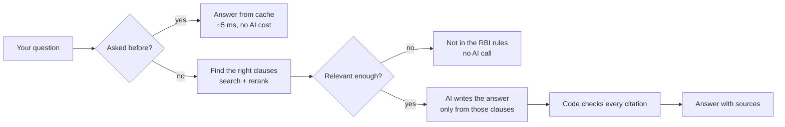
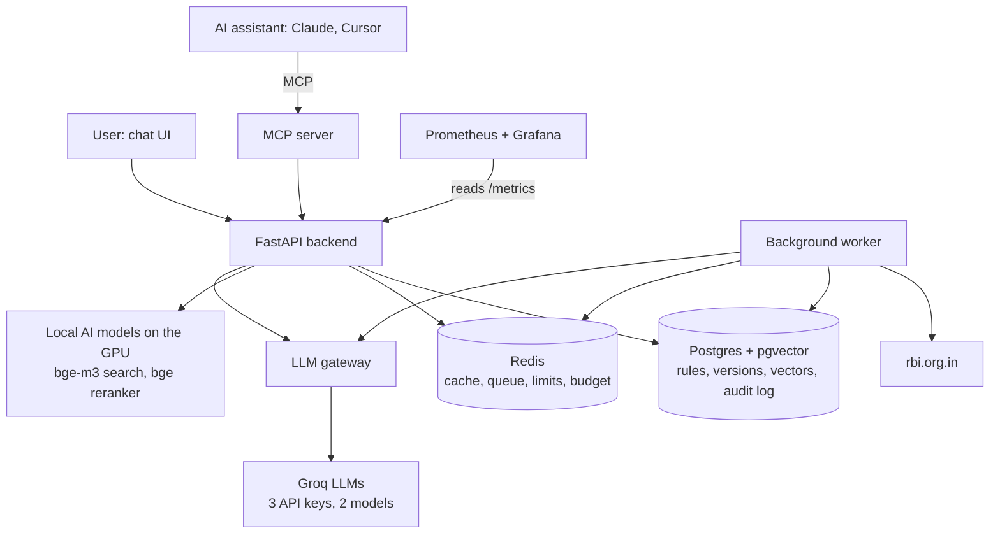
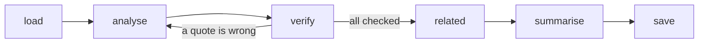

# AdvancedRag, explained simply

A plain-language guide to what this project is, why it exists, how to use it, how it is
built, and what makes it more than a basic RAG demo. Every number here was measured on
this project; the technical details are in the [design doc](design.md) and the
[decision records (ADRs)](adr/).

---

## 1. What it is, in one minute

AdvancedRag is a **compliance assistant for Indian finance companies (NBFCs)**.

You ask a question about the Reserve Bank of India's rules, in **English, Hindi or
Hinglish**, for example *"Gold loan par LTV ki limit kitni hai?"*. It answers from the
real RBI rules, and **every sentence points to the exact paragraph** it came from, with
a link to the official text.

It also **watches RBI for changes**. When a rule changes, it shows what changed and
explains it: who is affected, what to do, and which other rules to check.

If the rules do not cover a question, **it says so instead of guessing**.

---

## 2. Why it exists

| The problem | What happens today | What AdvancedRag does |
|---|---|---|
| The rules are huge | 45 RBI Master Directions, thousands of paragraphs | Searches all of them in about a second |
| The rules keep changing | People miss amendments | Checks daily, diffs paragraph by paragraph, explains the change |
| General chatbots make things up | No source, may be out of date, confident and wrong | Answers only from the rules, cites every sentence, refuses when unsure |
| Many users think in Hindi or Hinglish | Most tools work only in English | Answers in the language and script of the question |
| "What was the rule last year?" | Hard to find old versions | The date picker answers with the rules in force on that date |

In compliance a wrong answer can mean a penalty. So the project is built around one
idea: **an answer you can check is worth more than an answer that sounds good.**

---

## 3. How to use it

| Way | Who it is for | How |
|---|---|---|
| **Chat UI** | Anyone | Open the web page, type a question, click a citation to read the clause |
| **Recent RBI changes** | Compliance teams | On the start screen: each change with an AI explanation and the before/after text |
| **AI assistants (MCP)** | People who work in Claude, Cursor, VS Code | The assistant calls this system as a tool and answers with RBI citations |
| **API** | Developers | `POST /ask`, `POST /ask/stream`, `POST /search`, `GET /changes` (docs at `/docs`) |
| **Dashboard** | Whoever runs it | Grafana: speed, errors, cost, cache hits, background jobs |

How to start it and what to try: see "Quick start" in the [README](../README.md).

---

## 4. What happens when you ask a question

1. **Cache:** the same question was asked before (and the rules have not changed)?
   Answer at once.
2. **Search:** find the clauses that match, in two ways at once: by meaning (vectors)
   and by exact words (keywords), then put both lists together.
3. **Rerank:** a second, more careful model rereads the top 30 clauses and keeps the
   best 6.
4. **Relevance gate:** if even the best clause is a poor match, stop: "not in the RBI
   rules". The AI is never asked, so it cannot invent an answer.
5. **Answer:** the AI gets only those 6 clauses and must cite them as [S1], [S2]...
6. **Check:** code (not AI) checks that every citation points to a clause we actually
   gave it. An answer with no valid citation is labelled "unverified".
7. **Record:** question, clauses, model and answer are saved for audit.

You see the sources after about a second, then the answer appears word by word.

---

## 5. HLD: the big picture

| Part | Its job, in one line |
|---|---|
| **Chat UI** (React) | Ask questions, read sources, see recent changes |
| **Backend API** (FastAPI) | Runs the question pipeline; everything goes through it |
| **Postgres + pgvector** | One database for the rules, every version, the search vectors and the audit log |
| **Local models** (GPU) | Turn text into vectors, and rerank clauses. Free and private, no API cost |
| **LLM gateway** | The only door to the AI models: retries, fallbacks, limits, budget |
| **Redis** | Fast memory: answer cache, job queue, rate limits, daily token budget |
| **Worker** | Daily: download RBI rules, index them, find changes, explain them |
| **MCP server** | Lets AI assistants use this system as a tool |
| **Prometheus + Grafana** | Collect numbers and show them on a dashboard |

---

## 6. LLD: the important pieces, simply

**How the rules are stored**

- `documents`: one row per RBI direction (45).
- `document_versions`: every version with the date it applied from and to (96 so far).
  This is what makes "rules on a past date" possible.
- `chunks`: each rule split into clauses (3,707), never cutting a numbered clause in
  half, with its paragraph number and any amendment note.
- `chunk_embeddings`: one vector per clause, for search by meaning.
- `change_events`: each detected change, its paragraph diff and the AI's explanation.
- `answer_logs`: every answer ever shown, for audit (including cache hits).

**The LLM gateway** (one place for all AI calls)

- Tries the best model first, on each of 3 API keys, then a smaller model.
- Waits and retries when the provider says "too many requests", for as long as it asks.
- **Circuit breaker:** a model that keeps failing is skipped for a minute, so it does
  not slow every request down.
- **Daily token budget:** after the limit, requests start at the cheaper model.

**Search**

- Vector search (meaning) + keyword search (exact words), joined with weighted
  "reciprocal rank fusion". Keyword search counts 0.3, because tests showed equal
  weight made results *worse*.
- Cross-encoder reranker on the top 30. It is the slowest step (~650 ms) and the
  biggest gain, so it stays.

**Background jobs** (a small queue written by hand on Redis Streams)

- Job chain: download RBI → index → diff changes → explain changes, daily at 06:30 IST.
- A failed job is retried later (1 min, 2 min, ...); after 3 failures it goes to a
  "dead letter" list for a person to look at. If the worker crashes mid-job, another
  picks the job up.
- **Outbox pattern:** a change is recorded in the same database transaction as the new
  version, so a change can never be lost or recorded twice.

**The change-impact agent** (LangGraph)

The AI explains each changed paragraph and must quote the old and new text **word for
word**. Code checks the quotes; a wrong quote is sent back with the reason (twice at
most), otherwise the paragraph is marked "unverified".

---

## 7. Guardrails: how it avoids wrong or harmful answers

| Guardrail | What it stops |
|---|---|
| **Relevance gate** | Off-topic questions ("cricket world cup") never reach the AI |
| **"Not in sources" signal** | The AI can say the clauses do not answer the question, instead of guessing |
| **Citation check in code** | Answers citing clauses we did not give it; uncited answers are labelled "unverified" |
| **Prompt-injection fencing** | Text inside a regulation is treated as content, never as instructions to the AI |
| **Answer-language line** | Hinglish questions answered in Devanagari (fixed: 2/7 → 9/9 correct) |
| **Rules about wording** | "may" turning into "must", or a limit losing its condition |
| **Quote verification (agent)** | Change explanations that quote text that is not there |
| **As-of date** | Mixing old and new versions of a rule |
| **Audit log** | "Who was told what, from which clauses, by which model?" always has an answer |
| **Honest labels** | AI-reviewed test data is marked "ai:claude", never "human-reviewed" |
| **Rate limit and load shedding** | One user, or a traffic spike, taking the system down |

---

## 8. Cost and speed: what was optimised, and the measured result

| Choice | Effect |
|---|---|
| Search and rerank models run **locally on the GPU** | No per-query API cost; data stays private |
| **Answer cache** (exact question + date + rules version) | Repeat question: **~5 ms instead of ~3 s, zero tokens** |
| No AI call for off-topic questions | Declined questions cost nothing |
| **3 API keys, model fallback** | When one key hits its limit, the next is used at once |
| **Daily token budget** | Past the limit, the cheaper model answers instead of failing |
| **Cost per answer on the dashboard** | About **$0.0004** per uncached answer at list price |
| Streaming | The user sees sources after ~1 s, not a blank screen for 3 s |
| Load shedding | With 16 users at once, response time stays at **3.8 s instead of 38 s** |

One thing deliberately *not* done: a "similar question" cache. "Can NBFCs do video KYC?"
and "Can banks do video KYC?" are similar questions with different answers. In
compliance only exact repeats are safe to reuse.

---

## 9. How we know it works

| Test | Result |
|---|---|
| Right clause in the top 5 (144 questions, 3 languages) | **96.5%** |
| Right clause first | **86.1%** |
| Answer claims supported by their sources (checked by a different AI) | **95.9%** |
| Numbers in answers found in the cited clause | **100%** |
| Off-topic questions correctly refused | **20 / 20** |
| The checker caught deliberately planted wrong numbers | **10 / 10** |
| Capacity of one laptop GPU | ~1.2 searches/s; ~90 cached answers/s |
| Automated tests | 218 backend + 25 frontend, run on every commit (CI) |

The test questions were made by an AI, then reviewed clause by clause (also by an AI,
and labelled that way): 39 were rewritten and 9 dropped. A human check is still on the
to-do list.

---

## 10. Why this is "advanced"

| A basic RAG demo | This project |
|---|---|
| Upload a PDF, ask questions | Crawls the official source daily, keeps every version |
| Vector search only | Hybrid search + reranker, with each part measured |
| Trusts the AI's answer | Checks citations and quotes **in code** |
| Always answers | Refuses when the rules do not cover it |
| English only | English, Hindi and Hinglish, each in the right script |
| "It looks right" | Measured: retrieval, faithfulness, refusals, load |
| One API key, crashes on limits | Gateway: retries, fallback, circuit breaker, budget |
| No idea what it costs or how fast it is | Metrics, dashboard, cost per answer |
| Falls over under load | Load-tested; rate limiting and load shedding |
| Static data | Detects changes and explains them with an agent |
| Only a chat box | Also an API and an MCP tool for AI assistants |

Every major decision is written down with its reason and the alternatives considered:
14 short [ADRs](adr/).

---

## 11. Honest limitations

- Covers RBI NBFC Master Directions only (not SEBI, IRDAI, or bank directions).
- Runs on one laptop GPU: about 1.2 new searches per second.
- The test set is AI-made and AI-reviewed; a human spot-check is still to do.
- The change-impact agent has been tested on one real amendment so far, and its
  severity labels are the AI's judgement (quotes are checked, labels are not).
- Not legal advice: it points to the official text so a person can confirm.

---

## 12. Interview cheat-sheet

**30-second pitch**

> "I built a compliance copilot for RBI's NBFC regulations. You ask in English, Hindi or
> Hinglish and get an answer where every sentence cites the exact paragraph. It refuses
> when the rules don't cover the question. Behind it: hybrid search with a reranker,
> an LLM gateway with fallback and a token budget, a cache, a job queue that tracks RBI
> changes daily, and a LangGraph agent that explains each change with code-verified
> quotes. I measured everything: 96.5% retrieval hit rate, 95.9% supported claims, and
> I load-tested it and fixed a collapse under concurrency."

**Questions you may get, and short answers**

| Question | Answer |
|---|---|
| How do you stop hallucination? | Relevance gate, answer only from given clauses, "not in sources" option, citation check in code, and an evaluation with a judge from a different model family |
| Why hybrid search? | Vectors catch meaning, keywords catch exact terms like "V-CIP". I measured it: equal weights made results worse, so keywords count 0.3 |
| Why a reranker if it is slow? | It is the biggest accuracy gain (+5 points top-5). Reranking 10 instead of 30 dropped accuracy from 94% to 88% |
| How do you handle LLM rate limits? | A gateway: token bucket, retries honouring Retry-After, 3 keys, model fallback, circuit breaker |
| How do you control cost? | Local embedding models, exact-match cache, no LLM call for off-topic questions, daily token budget with a cheaper fallback, cost per answer on a dashboard |
| Why not a semantic cache? | Similar compliance questions can have different answers (NBFC vs bank). Only exact repeats are safe |
| What did the load test show? | The GPU caps at ~1.2 searches/s; at 16 users throughput fell to 0.5/s with a 38 s p95. A concurrency gate kept it at 1.15/s and 3.8 s |
| Why LangGraph for the agent? | The flow has a verify-and-retry loop and a skip branch; a graph makes those explicit and testable. Model calls still go through my gateway |
| How do you know the agent is right? | Every claim quotes the text word for word, and code checks it. Labels like severity are marked as AI judgement |
| Why one database? | Postgres + pgvector holds rules, versions, vectors and logs: one backup, one transaction, filters and search in one query |
| What would you do next? | A human check of the test set, exact-term test questions, cloud deployment, more regulators |

---

## 13. Words used here

| Word | Meaning |
|---|---|
| **RAG** | Retrieval-Augmented Generation: find the right text first, then let the AI answer from it |
| **Embedding / vector** | A list of numbers that captures a text's meaning, so similar meanings are close together |
| **Reranker** | A model that reads the question and each clause together to judge relevance more carefully |
| **RRF** | A way to merge two ranked lists (vector and keyword) into one |
| **LLM gateway** | One module that every AI call goes through, adding retries, fallback and limits |
| **Circuit breaker** | Stop calling something that keeps failing, try again after a pause |
| **Cache** | Remember an answer so a repeat question is instant and free |
| **Streaming (SSE)** | Send the answer piece by piece as it is written |
| **Queue / dead letter** | Jobs wait in line; jobs that fail every retry are parked for a person to inspect |
| **Outbox pattern** | Write the event in the same transaction as the data, so neither is lost |
| **Rate limiting** | Each user gets a fixed number of requests per minute |
| **Load shedding** | When full, refuse extra requests quickly instead of making everyone wait |
| **p95** | 95% of requests are faster than this |
| **MCP** | Model Context Protocol: the standard way AI assistants call external tools |
| **Agent (LangGraph)** | An AI workflow with steps, decisions and loops, drawn as a graph |
| **Guardrail** | A check that stops a wrong or unsafe output from reaching the user |
| **ADR** | Architecture Decision Record: a short note of a decision, its reason, its alternatives |
